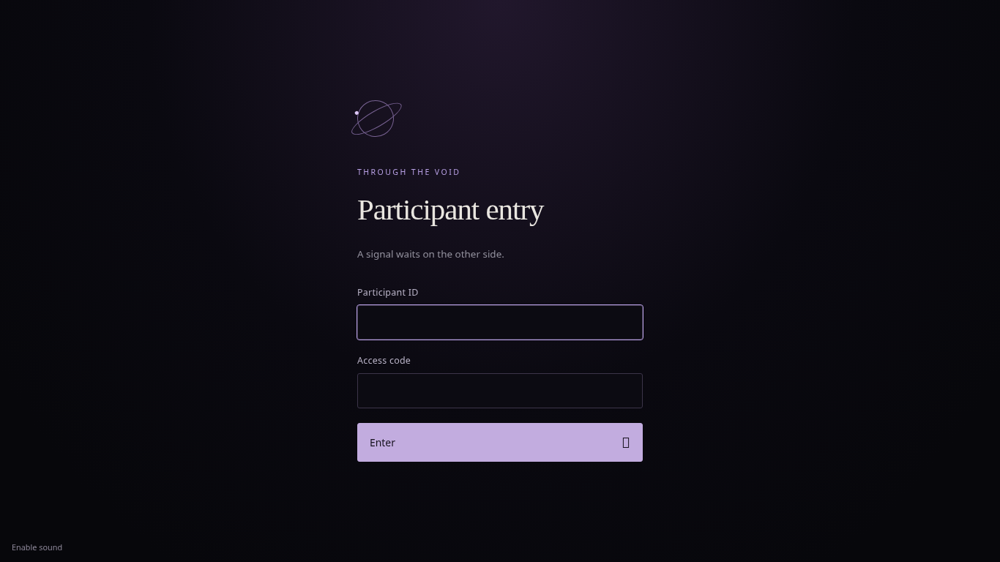

# Through the Void

A local astronomy puzzle hunt: one entrance, seven levels, a level 7 helper, and a completion page. Flask renders the pages; SQLite stores identities, opaque sessions, unlocks, event times and the supervised AI ledger. Waitress serves the application. All artwork, fonts, audio and scripts are local. There is no AI integration.

Requires Python **3.11 or newer** (validated on Python 3.12, Linux). Keep the entire repository on the organizer's laptop; never distribute it to participants. The source, assets and organizer documents contain solutions.

## Screenshots

These are actual screenshots from the Chromium browser walkthrough. Keep the repository private during the event because its source and assets contain the complete puzzle solutions.

Participant entry:



Homepage:


Example puzzle page:


## Linux setup

Run from this directory:

```sh
bash scripts/setup-linux.sh
.venv/bin/python manage.py organizer YOUR_ORGANIZER_NAME
bash scripts/start-linux.sh --host 0.0.0.0 --port 8080
```

The organizer command securely prompts for a password of at least 14 characters. There is no default organizer password. Running it again resets that account's password and revokes its sessions. Setup is repeatable and does not reset event data.

## Windows setup

In PowerShell, from this directory:

```powershell
.\scripts\setup-windows.ps1
.\.venv\Scripts\python.exe manage.py organizer YOUR_ORGANIZER_NAME
.\scripts\start-windows.ps1 -BindAddress 0.0.0.0 -Port 8080
```

If your organization's PowerShell policy disallows scripts, run their Python commands directly; do not relax a managed execution policy. The Windows scripts are provided but have not been executed on Windows in this environment.

If organizer sign-in fails, run the following from the folder containing `manage.py`. Use the **same data directory as the server**, including a rehearsal directory if selected:

```powershell
.\.venv\Scripts\python.exe manage.py --data-dir "C:\path\to\your\instance" status
.\.venv\Scripts\python.exe manage.py --data-dir "C:\path\to\your\instance" organizer testadmin
```

`status` displays the resolved database path and organizer names, without passwords. The second command securely sets a new password for that exact account; use it at `/organizer/login`. The server also prints its database path at startup. Organizer usernames are case-sensitive. After eight login submissions in one minute, wait a full minute before retrying. Cookies are shared across ports: use separate browser profiles or a private window for rehearsal and the official event.

## Update an existing Windows event safely

Keep the existing data directory. Do not extract a new release over it or delete `void.sqlite3`, `-wal`, or `-shm`. Stop the old server with Ctrl+C, then make a consistent backup using its `manage.py backup` command. Extract the new release into a **separate** application folder, open PowerShell there, and run:

```powershell
$voidData = "C:\path\to\EXISTING\instance"
py -3 -m venv .venv
.\.venv\Scripts\python.exe -m pip install -r requirements.txt
.\.venv\Scripts\python.exe manage.py --data-dir "$voidData" status
.\.venv\Scripts\python.exe manage.py --data-dir "$voidData" sync-assets
.\.venv\Scripts\python.exe manage.py --data-dir "$voidData" check
.\.venv\Scripts\python.exe manage.py --data-dir "$voidData" serve --host 0.0.0.0 --port 8080
```

Replace `$voidData` with the server's actual absolute data path. Keep this setting when restarting; otherwise the default is the new application's `instance` directory. Check that each command succeeds before continuing. Startup automatically adds the gate tables and creates a consistent private backup under `backups/before-gate-migration-*.sqlite3` before upgrading an existing database. Migration preserves all existing tables and records, including sessions, progress, AI use, unlock/completion times, and event clocks.

`sync-assets` updates only the four known clue recordings and their manifest entries, backing up originals under the selected data directory's `backups/audio-before-seals/`. It refuses unrecognized recordings, preserves unrelated assets/hotspots and event state, and can be repeated. Already unlocked levels stay unlocked after this update; new credentials apply to gates still locked. The normal new-install setup already includes the revised audio.

## Run the event

1. Find the laptop's LAN IPv4 address using `ip -4 addr` on Linux or `ipconfig` on Windows. Binding to `0.0.0.0` listens on all IPv4 interfaces; it is not a participant destination address.
2. Open `/organizer/login` on the organizer laptop, using the server's address and port. Create each participant ID and copy its generated access code immediately. A replacement code can be issued without losing progress.
3. Participants use the laptop's LAN IP, for example `http://192.168.1.10:8080/entry`. They use participant IDs and access codes here; puzzle usernames/passwords are entered later at puzzle gates.
4. Complete the private [event checklist](docs/EVENT_DAY.md), then explicitly start the event in organizer control. The server persists a six-hour deadline. Refresh organizer control to see updated progress and server time.
5. Use organizer control to record each supervised AI prompt, audit corrections, apply policy blocks, and export results or the complete audit ledger.

Before start, puzzle pages and assets are unavailable. After expiry, already unlocked material stays available, while new unlocks and completions are refused. Completion is recorded once. All timestamps in the event interface and CSV are explicitly UTC; elapsed time is seconds since the authoritative event start. The poster's printed date does not start the event.

The server does not modify firewall or network settings. An organizer must allow inbound TCP 8080 on the intended private LAN, disable Wi-Fi client isolation if needed, and keep the laptop awake. Test from a separate participant PC before the event. Neither cloud validation nor binding a port proves physical LAN reachability.

## Assets and private data

All 16 required assets are included under `instance/assets/`, with their exact filename case. Twelve retain their original bytes; four clue recordings now append spoken digits while preserving the original compressed poem packets. Byte-for-byte original recordings are backed up in private `instance/originals/audio-before-seals/`. The supplied archive and source text are preserved under `instance/originals/`. Neither directory is exposed as a static directory. Only explicitly allowlisted individual asset routes are served, after authorization. Database files, source files, documents and the ZIP have no serving routes.

```sh
.venv/bin/python manage.py check
# Optional for an empty asset directory only: import the original supplied archive.
# This does NOT include the new spoken digits. Run sync-assets after importing.
# Existing different files (including the revised clips) are never overwritten.
.venv/bin/python manage.py import-assets "/path/to/Through The Void files.zip"
```

`check` verifies all assets against the current asset manifest and validates both hotspot boxes. Organizer event start requires the same preflight. The known filename differences and precise clue caveats are in the private [organizer guide](docs/ORGANIZER.md).

Event state lives in ignored `instance/void.sqlite3` and its SQLite journal files. Back up with SQLite's backup API while the server runs:

```sh
.venv/bin/python manage.py backup /private/backups/void-event.sqlite3
```

On Windows use `.venv\Scripts\python.exe`. Store backups privately. To restore, stop the server, preserve the current database and its `-wal`/`-shm` files together, then replace them with a consistent backup and restart. Never restore into a live database. To rehearse a fresh event, copy the application directory to a private rehearsal location excluding `void.sqlite3*`; do not reset the real event database.

`VOID_DATA_DIR` can select another private state directory. Copy `assets/`, `asset-report.json` and `hotspots.json` there before first use. `manage.py --data-dir /private/path ...` is an equivalent explicit option. On Linux, restrict this directory to the server account (`chmod 700`); on Windows use a private user directory with appropriate ACLs.

## HTTP and HTTPS

The default is LAN HTTP with HttpOnly, SameSite=Lax cookies, CSRF tokens and opaque server-side sessions. HTTP does **not** encrypt access codes or session cookies. Use only a trusted, isolated event LAN if you choose HTTP. Organizer access should use the laptop's own browser; do not share an organizer browser profile with participants.

For stronger protection, place a properly configured local HTTPS reverse proxy in front of Waitress, distribute its trusted certificate to managed PCs, and set `VOID_HTTPS=1` before starting the app. This sets Secure cookies. Set this only when clients actually use HTTPS, otherwise they cannot stay signed in. Bind Waitress to loopback behind the proxy; do not expose its upstream port to participant PCs. Configure TLS and proxy networking explicitly; this project does not change host networking or blindly trust forwarded identity headers. HTTPS termination has not been exercised in the cloud tests.

## Development and verification

```sh
.venv/bin/python -m pip install -r requirements-dev.txt
.venv/bin/python -m pytest -q
```

The optional real-browser checker uses a disposable database and a real Waitress process; it never changes the live event:

```sh
.venv/bin/python -m pip install -r requirements-browser.txt
.venv/bin/python tests/browser_check.py --engine chromium --executable /usr/bin/chromium
.venv/bin/python tests/browser_check.py --engine firefox --executable /path/to/firefox --driver /path/to/geckodriver --port 8082
```

Install the selected browser and the official Mozilla geckodriver separately. Browser dependencies are for development only. Screenshots, logs and machine-readable outcomes go into ignored `test-results/`. See [verification results and limits](docs/VERIFICATION.md). Installed runtime dependencies require no internet; an offline reinstall can use a platform-specific wheelhouse created beforehand with `python -m pip download -r requirements.txt -d wheels`, then `pip install --no-index --find-links wheels -r requirements.txt`.

The optional private audio build tool is `scripts/update_clue_audio.py` (FFmpeg with flite required). Delivered MP3s are ready to use; organizers need no speech-generation tools. `scripts/verify_audio.py` checks original packet preservation and clipping; adding `--recognize` also requires PocketSphinx 5.1.0 and tests the slowed tails against all ten digits. These tools are outside web-accessible directories and add no application dependencies.

The existing checkout is sufficient for cloud tasks; do not create a Git worktree unless explicitly requested. Application startup does not push or publish the repository.

## Participant Linux event mode

The separate [CTF Event Mode toolkit](tools/event-mode/README.md) provides administrator-managed balanced/strict participant egress controls, editable lists, browser policies and timed rollback. It does not activate with the website. Deploy only its [standalone ZIP](downloads/ctf-event-mode.zip) to participant PCs, after the documented one-PC pilot; keep this application's source and solutions off participant machines. Host-local controls cannot guarantee zero AI access with unrestricted internet or administrator privileges.
